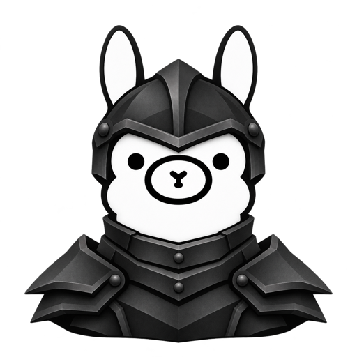

  

# HardLlama

HardLlama is a hardened version of the [Ollama](https://github.com/ollama/ollama) desktop app for Apple Silicon Macs. It keeps saved chats encrypted on disk, even while the app is open, and locks the chat window when you leave.

It's an unofficial fork, not made by or affiliated with Ollama.

## What's different from Ollama

- **Password required.** Unlock the desktop app to read or write chats.
- **Chats encrypted on disk.** Messages, titles, attachments, timestamps, model names and more are encrypted with AES-256-GCM before they're saved.
- **Locks when you leave.** It locks when you quit, lock your screen, your Mac sleeps, you go idle, or soon after you switch away, on a delay you choose. A message you were typing, and a reply still being written, are kept encrypted and come back when you unlock.
- **Private chats** that stay in memory and are never written to disk.
- **No cloud.** Ollama's cloud models, web search, account sign-in, update checks and connections to other companies' AI apps are turned off.
- **Run models on another computer (experimental).** Pair with another HardLlama, such as one with a faster GPU, while your chats stay on yours.
- **[Search a folder](HARDLLAMA.md#searching-a-folder-in-chat).** Each chat can keep an encrypted snapshot of your documents and retrieve relevant passages as you ask questions.
- **[Export a chat](HARDLLAMA.md#exporting-a-chat).** Save a transcript as PDF, plain text, or Markdown, with reasoning traces if you choose.
- **Custom instructions** and a **context counter** that shows how much of the model's context window a chat uses.

See [HARDLLAMA.md](HARDLLAMA.md) for the details, including [what it doesn't protect against](HARDLLAMA.md#what-this-doesnt-protect-against).

## Install

HardLlama isn't distributed as a download. You build it yourself on an Apple Silicon Mac running macOS 14 or newer, and it takes a few minutes. Follow [Building](HARDLLAMA.md#building).

It installs alongside the official Ollama app, with its own data, port and login item. See [Alongside the official app](HARDLLAMA.md#alongside-the-official-app).

**There is no password reset.** If you forget your password, your chats are gone.

## Status

HardLlama is early and changing quickly. It has only been tested on Apple Silicon Macs. Windows support is in progress. Nothing updates by itself, so see [Updating](HARDLLAMA.md#updating) for how to keep it current.

## Using models

HardLlama's server, models and `ollama` command line are Ollama's own, unchanged. For downloading models, the command line and the API, see [Ollama's documentation](https://github.com/ollama/ollama/tree/main/docs). HardLlama's server listens on port 11439 rather than 11434, so it doesn't clash with the official app.

## License

MIT, the same as Ollama. See [LICENSE](LICENSE). Ollama is a trademark of its owners.
